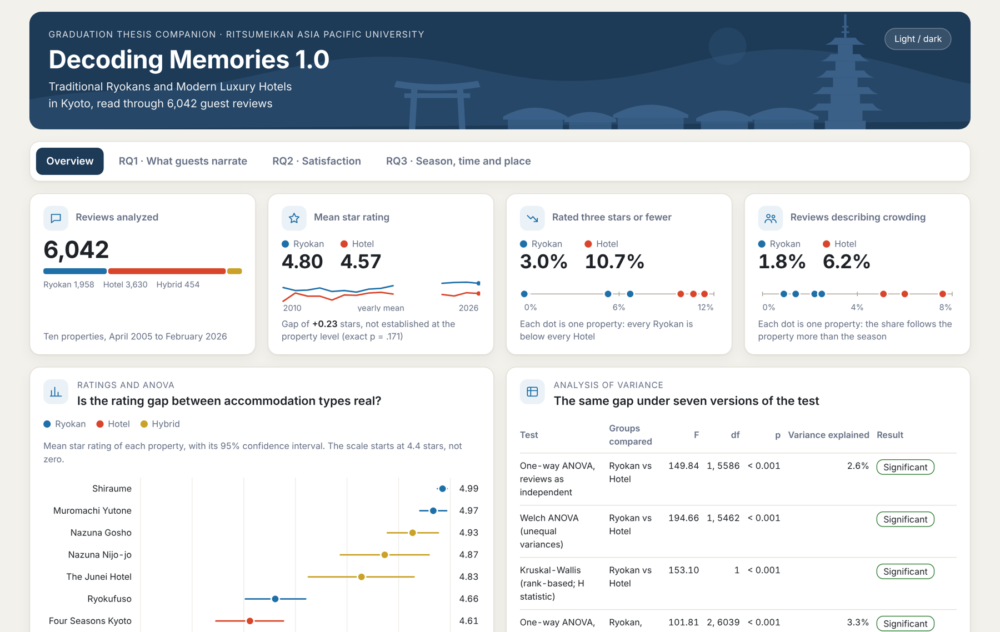
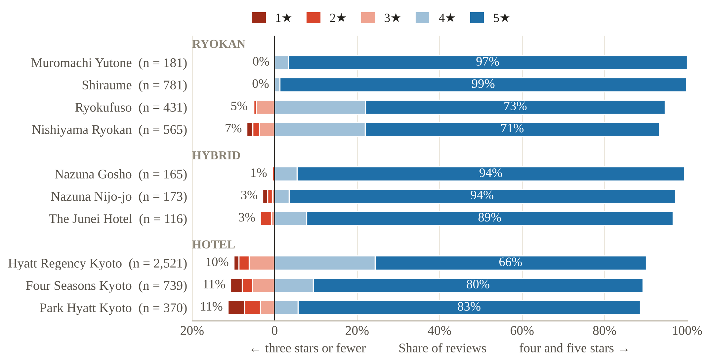
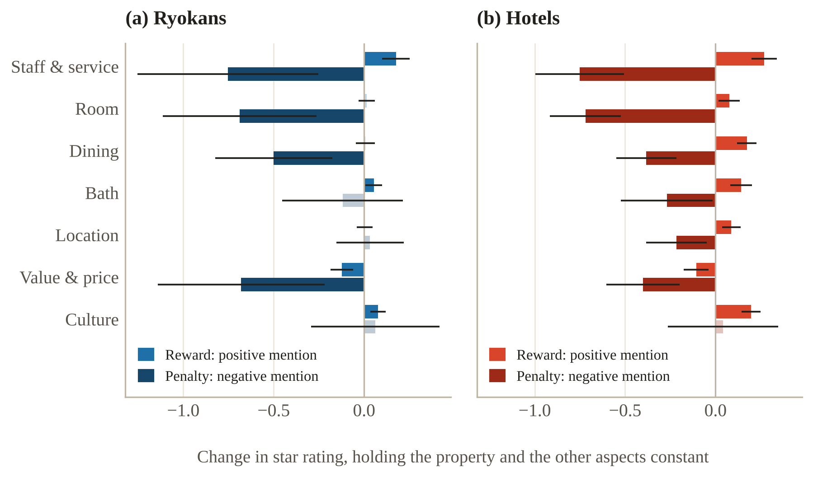
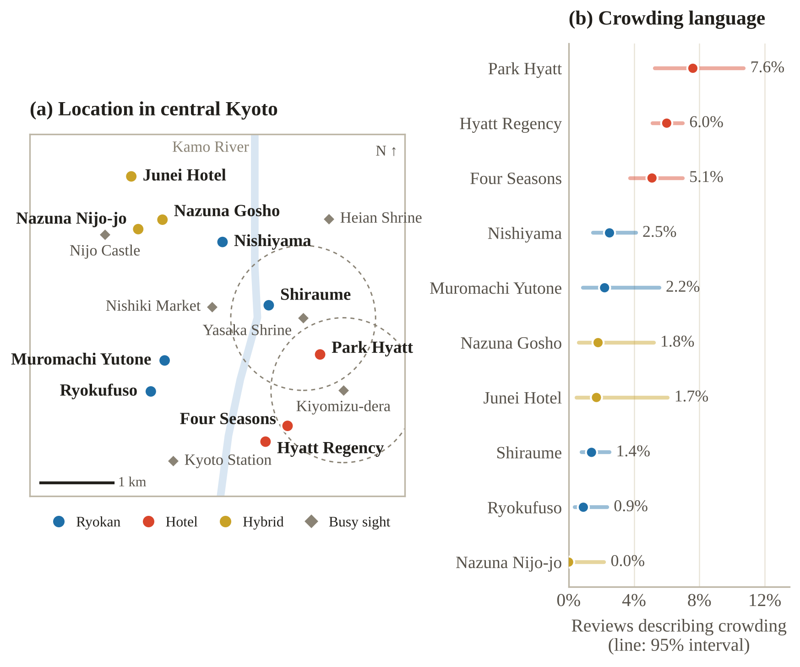

<p align="center">
  
</p>

<p align="center">
  <a href="https://spydersh.github.io/decoding-memories/"><b>Live dashboard</b></a>
  &nbsp;·&nbsp; <a href="#findings">Findings</a>
  &nbsp;·&nbsp; <a href="#data-and-method">Method</a>
  &nbsp;·&nbsp; <a href="#reproduce">Reproduce</a>
</p>

# Decoding Memories 1.0

Kyoto hosts two very different kinds of luxury stay: the traditional ryokan and the international
luxury hotel. This project reads 6,042 English-language TripAdvisor reviews of ten Kyoto properties,
posted between April 2005 and February 2026, and asks three questions.

1. **What do guests write about** after they leave?
2. **What moves the star rating** up or down?
3. **Does the peak tourist season** hurt one type more than the other?

It is my graduation thesis in Data Science at Ritsumeikan Asia Pacific University (College of
Sustainability and Tourism, supervisor: Professor DAHLAN Nariman, submission March 2027).

<p align="center">
  <a href="https://spydersh.github.io/decoding-memories/">
    
  </a>
  <br><sub>The interactive dashboard. One HTML file, no server, works offline.</sub>
</p>

## Findings

Three hypotheses were tested. One is partly supported and two are not confirmed, and the thesis
reports all three the same way.

| | Hypothesis | Verdict | Evidence |
|---|---|---|---|
| **H1** | Guests reward the people more than the place | **Partly supported** | A review that praises the staff is rated +0.24 stars higher, and one that praises the room +0.06, holding the property and the other aspects constant. The gap of 0.18 stars (95% CI 0.12 to 0.25) remains whichever property is left out. Complaints cost about the same for both (−0.77 and −0.73). |
| **H2** | Ryokans are rated higher than hotels | **Not confirmed** for mean ratings | The four ryokans average 4.80 stars and the three hotels 4.57. With the property as the unit, the exact permutation test gives p = .171. Exploratory: every ryokan has fewer low ratings than every hotel (3.0% vs. 10.7%). |
| **H3** | Ryokans hold their ratings better in peak months | **Not confirmed** | Hotel ratings fall by 0.075 stars in peak months and ryokan ratings do not, but the difference is not statistically established (+0.080, 95% CI −0.006 to +0.167, p = .070). Exploratory: every hotel has more reviews that describe crowding than every ryokan (6.2% vs. 1.8%). |

What guests write about differs more clearly than how they rate. Staff and service appear in about
87% of reviews of both types, while culture and tradition appear in 58.5% of ryokan reviews and
34.7% of hotel reviews, with every ryokan above every hotel.

### The same gap, two answers

Counted as 5,588 independent reviews, the rating gap between ryokans and hotels is "highly
significant" (p < .001). But reviews of one property share its building, its staff, and its
price, so the honest sample size is seven properties, and at that level the gap is not established
(p = .171). Every comparison of types in this project therefore uses the property as the unit and
an exact permutation test over all 35 ways of assigning seven properties to the two types.

<p align="center">
  
  <br><sub>Share of each star rating, by property. Two ryokans sit close to the hotels.</sub>
</p>

<p align="center">
  
  <br><sub>Change in star rating when a review praises or criticizes each aspect. Penalties are far larger than rewards.</sub>
</p>

<p align="center">
  
  <br><sub>Crowding language follows the type of property more than its place on the map.</sub>
</p>

## Data and method

| | |
|---|---|
| **Reviews** | 6,042 English-language TripAdvisor reviews, 49,909 sentences |
| **Properties** | 4 ryokans (1,958 reviews), 3 luxury hotels (3,630), and 3 hybrid properties (454) that are reported separately and left out of the tests |
| **Sentiment** | VADER on each sentence as the primary measure. Checked against a DistilBERT classifier, TextBlob, and 294 sentences labeled by hand |
| **Aspects** | A dictionary of seven aspects (staff and service, room, dining, bath, location, culture, value and price) and a keyword list for crowding |
| **Topics** | LDA, with the number of topics chosen by coherence and checked for stability |
| **Tests** | Exact two-sided permutation tests at the property level, mixed models with a random intercept for the property, and leave-one-property-out checks |
| **Tools** | Python (pandas, statsmodels, scikit-learn, gensim, vaderSentiment, Hugging Face Transformers), D3.js for the dashboard |

## Repository layout

```
decoding-memories/
├── docs/index.html      the interactive dashboard (served by GitHub Pages)
├── dashboard/source/    the files the dashboard is built from
├── data/                one row per review: rating, date, sentiment scores, aspect codes (no review text)
├── scripts/             the analysis, in the order it was run (phase 1 to phase 6), and the figure scripts
├── notebooks/           the Colab notebook that scores sentences with the transformer classifier
├── results/             the output of the scripts as reported in the thesis
└── figures/             the nineteen figures of the thesis
```

## Reproduce

Python 3.10 or later. Install the packages with `pip install -r requirements.txt` and run every
command from the root of the repository.

The figures of the appendix and the two diagrams can be redrawn from the files in this repository:

```
python scripts/figure_scripts/make_figures2.py scripts/phase5_location_crowding_anova figures_out
python scripts/figure_scripts/make_diagrams.py figures_out
```

The full pipeline needs the review texts, which are not part of this repository (see
[Data availability](#data-availability)). With the folder `data_raw/` placed in the root, the steps are:

| Step | Command | What it does | Where it appears in the thesis |
|---|---|---|---|
| 1 | `python scripts/phase1_audit_and_rerun.py data_raw` | Audit of the raw files (missing text, duplicates, language); first property-level rating comparison and seasonal models | Sections 3.1 and 3.2 |
| 2 | `python scripts/phase2_rerun.py data_raw/processed_reviews_all.csv` | LDA topic model: number of topics by coherence, stability across random initializations, property leakage; removal of property-specific terms | Table 4, Appendix B |
| 3 | `python scripts/phase3_extended_analyses.py data_raw/processed_reviews_all.csv .` | Sentence-level VADER scores; aspect dictionary; distinctive vocabulary; aspect salience and sentiment; rewards and penalties; importance and performance; peak-end test; recommendation, return, and memory proxies; low-rating classifier; long-run trend. Writes `phase3_review_features.csv` beside the script and `phase3_sentences.pkl` in the root | Tables 5 to 7, Figures 4 to 11, Appendix C |
| 4 | `notebooks/Bert_Sentiment.ipynb` (Google Colab; the same code is in `scripts/colab_bert_sentiment.py`) | Scores every sentence with the transformer classifier and TextBlob; draws the labeling sample | Section 3.3.4 |
| 5 | `python scripts/phase4_bert_validation.py` | Agreement of the three sentiment measures with the human labels; rewards and penalties with transformer scores | Tables 17 and 18 |
| 6 | `python scripts/phase5_location_crowding_anova/anova.py` | One-way, Welch, Kruskal-Wallis, and nested analysis of variance; Levene and Tukey tests | Table 11, Appendix B |
| 6 | `python scripts/phase5_location_crowding_anova/datasets.py` | Property summary, aspect shares, narrative arc, complaints | Figures 17 and 19 |
| 6 | `python scripts/phase5_location_crowding_anova/location.py` | Distances, rank correlations with permutation p-values, crowding language (about two minutes) | Tables 9 and 20, Figure 12 |
| 6 | `python scripts/phase5_location_crowding_anova/extra.py` | Correspondence analysis, co-occurrence of complaints, rewards with both sentiment measures | Figures 16 and 18 |
| 6 | `python scripts/phase5_location_crowding_anova/topics.py` | Topic shares by accommodation type and period | Table 4 |
| 7 | `python scripts/phase6_final_checks/checks.py data/phase3_review_features.csv phase3_sentences.pkl` | Exact permutation tests for every outcome; seasonal models with 95% intervals and property-level tests; staff versus room contrasts, leaving out each property; single-aspect coding | Tables 5, 7, 8, 10, 18, and 19 |
| 7 | `python scripts/phase6_final_checks/checks2.py` | Logistic models of recommendation, return intent, and memory language, leaving out each property; reward by type | Figure 9, Table 19 |
| 7 | `python scripts/phase6_final_checks/checks4.py` | Largest reward when each property is left out | Section 5.1.1 |
| 7 | `python scripts/phase6_final_checks/checks5.py data/phase3_review_features.csv crowdflags.pkl` | Robustness of the rating difference; Cohen's d; crowding language and ratings | Table 16, Sections 4.4.3 and 4.5.3 |

Step 5 also needs the hand-labeled sample, which is kept with the review texts. The random seeds
are fixed in the scripts, so a rerun on the same data reproduces the files in `results/` and the
`*_out.txt` files in `scripts/phase6_final_checks/`.

To rebuild the dashboard after a change: `npm install d3` inside `dashboard/source/`, then
`node dashboard/source/build_dashboard.js docs/index.html`.

## Data availability

The review texts were written by TripAdvisor users and remain subject to the terms of use of the
website, so they are not published here. This repository holds the derived dataset
(`data/phase3_review_features.csv`, one row per review without the text), the tables behind every
chart (`scripts/phase5_location_crowding_anova/*.csv`), and the output of every script. A few single
sentences appear as examples in `results/phase4_results.txt`. The review texts are available from
the author on request for the verification of the results.

## Limitations

- Ten properties in one city. The findings describe these properties and do not generalize to all ryokans or hotels.
- English-language reviews on one platform. One hotel contributes 69% of the hotel reviews.
- Sentiment comes from a general-purpose lexicon whose agreement with the hand labels is moderate (kappa = 0.34), and which finds only about half of the negative sentences.
- Authenticity, memory, and experienced crowding are not measured directly. They are read from what guests chose to write.

## How to cite

> Sai Htet Eain Lin. (2027). *Decoding Memories 1.0: A comparative big data study of traditional
> ryokans and modern luxury hotels in Kyoto by analyzing TripAdvisor reviews* [Graduation thesis,
> Ritsumeikan Asia Pacific University].

## About

**Sai Htet Eain Lin** · Data Science, Ritsumeikan Asia Pacific University ·
[LinkedIn](https://www.linkedin.com/in/saihteteainlin)

Parts of the analysis code, the statistical checks, and the editing were developed with the help of
an AI assistant (Claude, Anthropic). The research questions, the data collection, the hand
labeling, and the conclusions are the author's.

The code is released under the [MIT License](LICENSE). The figures and the text are © 2026
Sai Htet Eain Lin. Please cite the thesis when you use them.
